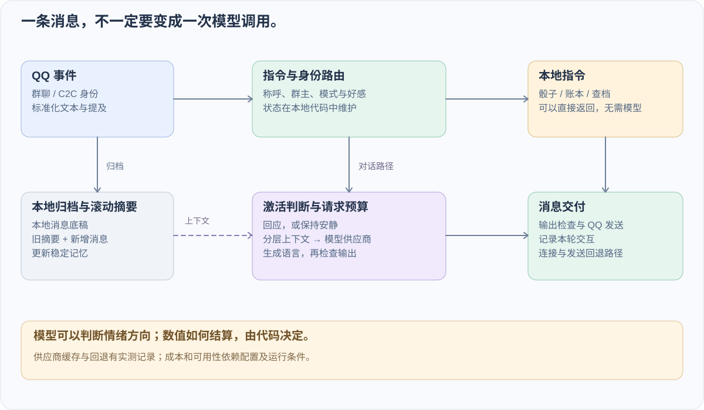

<div align="center">


# The Regular · 老群友

**把关系和记忆留在代码里，让模型负责接话。**

[](requirements.txt) [](bot.py) [](LICENSE)

**中文** · [English](README_EN.md)

[运行](#快速开始) · [消息路径](#一条消息三种去向) · [上下文设计](#上下文为什么要分层) · [玩法](#-群里怎么玩)

</div>

老群友是常驻 QQ 群的一个角色：大部分时候潜水，偶尔接一句话，逐渐熟悉群里的人。它有称呼、交情档位、人格模式、滚动《群史记》和承诺账本。

社交表面之下，是一个小型 Agent harness：**代码持有长期状态，激活策略决定什么时候开口，模型在有顺序的上下文里生成语言**。本地指令和可配置的供应商回退，让每次互动不必都依赖一次大模型请求。

## 可以玩到什么

| 互动 | 当前实现 |
| --- | --- |
| 越熟越有自己的语气 | 八档关系影响语气和激活；算分、衰减与上限由代码执行。 |
| 知道什么时候安静 | 提及/名字触发、概率、冷却、作息与激活状态共同控制回复。 |
| 本地小游戏与查档 | 骰子、好感查询、排行榜和账本查询有本地处理器。 |
| 认领或修改称呼 | 按群隔离身份，结合群主权限、名字检查和修改冷却。 |
| 切换全群气氛 | 公共人格模式，切换资格由本地状态决定。 |
| 记住群聊而不重放全部历史 | 本地消息底稿与“旧摘要 + 新消息”的滚动摘要。 |
| 观察供应商故障与恢复 | 按任务分层、供应商回退、连接恢复，并保留设计与测试记录。 |

## 一条消息，三种去向



| 输入示例 | 路径 | 状态怎样变化 |
| --- | --- | --- |
| `查好感` | 本地关系查询 | 读取已有状态，不让模型临时编一个分数。 |
| `掷骰子` | 本地游戏处理器 | 生成游戏结果，按规则结算相应交情变化。 |
| `叫我小林` | 称呼处理流程 | 检查权限与名字规则，必要时审核，再更新按群隔离的称呼记录。 |
| `@机器人 今天吃什么` | 生成回复 | 组装分层上下文，调用已配置的供应商，检查并记录回复。 |
| 没有提及机器人的普通聊天 | 激活门控 | 可以保持安静；满足条件时才生成一次接话。 |

这里展示的是执行路径，不是模型的固定台词。代码持有分数，意味着语言模型不会直接改写关系计数器；这不等于每一句生成文本都事实可靠。

## 上下文为什么要分层

[get_ai_reply()](bot.py) 把越稳定的材料放得越靠前：

| 层次 | 内容 | 为什么放这里 |
| --- | --- | --- |
| 1 · 稳定头 | 人设、共享规则、输出规则、可选协议 | 同群、同人格配置下尽量复用。 |
| 2 · 群长期记忆 | 当前滚动摘要 | 完成一次压缩后才更新。 |
| 3 · 会话历史 | 已接纳的对话轮次 | 沿着已有前缀追加。 |
| 4 · 本轮动态 | 发言人关系、附近聊天、群主/私聊/喊停提示、激活状态 | 随人和轮次变化，统一压到末尾。 |

构造回复与写回历史期间持有会话锁，避免并发撕裂。称呼从当前档案渲染，关系变化可以由摘要提取建议，但校验、封顶与持久化仍由本地代码完成。

这样的顺序为前缀缓存创造条件；实际效果取决于供应商与任务档位。[设计笔记](docs/DESIGN_NOTES.md) 区分了真实群聊观察、受控探针和回归检查，其中的测量只对应各自条件，不能当成通用命中率或月费承诺。

## 快速开始

### 1. 克隆与安装依赖

需要 Python 3.10+。项目极其轻量，**无数据库、无繁杂框架**，仅 5 个必要依赖：

```bash
git clone https://github.com/dubianche123/micro-banter-harness.git
cd micro-banter-harness

python3 -m venv .venv
source .venv/bin/activate
pip install -r requirements.txt
```

### 2. 配置 `.env`

复制配置模板：

```bash
cp .env.example .env
```

打开 `.env` 填入最核心的几项：

```env
# 1. 腾讯 QQ 开放平台凭证
QQ_APP_ID=你的AppID
QQ_APP_SECRET=你的AppSecret

# 2. 它在群里叫什么（触发词，支持多个别名，逗号分隔）
BOT_NAMES=小王,阿王,@小王

# 3. 群主私聊认领暗号（部署前改成只有你知道的一句密语）
OWNER_CLAIM_PHRASE=换成仅你知道的私密口令

# 4. 主 AI 供应商（gemini 或 zhipu）及密钥
AI_PROVIDER=gemini
GEMINI_API_KEY=你的GeminiKey
# ZHIPU_API_KEY=备用的智谱Key（可选）
```

### 3. QQ 开放平台与群内开关（关键两步）

1. **获取全量群消息**：进入你的 QQ 群设置 $\to$ 点击该机器人 $\to$ 将「机器人可获取的群聊消息范围」设为 **「获取群内全部消息」**（这是它能潜水看懂上下文的前提）。
2. **开启私聊（C2C）权限**：开放平台开启单聊权限，用于安全的群主认领与单聊。

### 4. 启动与常驻

```bash
# 直接前台运行
python bot.py

# 或后台挂载（走代理环境）：
HTTP_PROXY=http://127.0.0.1:7890 HTTPS_PROXY=http://127.0.0.1:7890 \
NO_PROXY=bigmodel.cn,open.bigmodel.cn nohup python -u bot.py >> bot.log 2>&1 &
```

> 🍏 **macOS 用户福利**：自带一键安装常驻守护脚本（防休眠 + 挂掉秒起）：
> ```bash
> bash tools/launchd/install.sh
> ```

### 5. 私聊认领群主

机器人启动后，**群主私聊给机器人发送你的暗号**（即 `OWNER_CLAIM_PHRASE`），机器人验证通过后，将永久绑定你的 OpenID 并把好感度锁在顶格，落锁授权。

---

## 🎮 群里怎么玩？

| 玩法 | 怎么说 | 消耗 Token |
| :--- | :--- | :---: |
| **日常聊天** | `@它` 或者直接喊它的名字（如 `小王 今天吃啥`） | 1 次 |
| **随缘插嘴** | 正常在群里聊天，它会按概率看心情接话 | 1 次 |
| **赛博决斗** | 发送 `掷骰子` / `摇骰子` / `比大小` / `决斗` | **0** |
| **认领/改名** | 发送 `叫我阿强` / `我是阿强` / `别叫我了` | 0~1 次 |
| **切换人格** | 发送 `猫娘模式` / `发疯模式` / `风纪委员模式` / `算命模式` / `老司机模式` | **0** |
| **恢复正常** | 发送 `恢复正常` / `正常点` / `冷静点` / `吃药了` | **0** |
| **查好感度** | 发送 `查好感` / `我跟你多熟` / `几档了` | **0** |
| **关系排行榜**| 发送 `关系榜` / `点名册` / `群友榜` | **0** |
| **群史记简报**| 发送 `群史记` / `最近聊了啥` / `周报` | **0** |
| **查承诺账本**| 发送 `查账` / `谁请客`；兑现后说 `结清` | **0** |
| **翻旧账查证**| 发送 `翻旧账 关键词`（从本地底稿检索真实发言） | **0** |
| **群主特权** | `@某人 叫他阿珍` / `锁起名` / `解锁起名` / `办他` / `护驾` | **0** |

---

## ⚙️ 常见配置项速览

在 `.env` 中可按需调整机器人的脾气与成本闸门：

* `BANTER_PROBABILITY`：潜水插嘴概率（默认 `0.08` 即 8%）
* `OWNER_MENTION_PROBABILITY`：聊到群主时的插嘴概率（默认 `0.25`）
* `BANTER_COOLDOWN_SECONDS`：插嘴冷却时间（默认 `120` 秒）
* `AI_DAILY_BUDGET`：每天全群 AI 调用上限总预算（默认 `3000` 次，防刷爆钱包）
* `MODE_SWITCH_MIN_AFFINITY`：模式切换门槛（默认熟人 `familiar` 起步，防路人捣乱）

---

## 📄 开源协议

本项目采用 [MIT License](LICENSE) 开源。
欢迎 Fork、Star 和贡献代码！让每一个群都拥有一个有血有肉的老群友。

## 不回应或只工作了一半时，看哪里

| 现象 | 优先检查 |
| --- | --- |
| 进程启动了，却看不到群聊 | QQ 沙箱成员与群设置里的 **获取群内全部消息**。 |
| 喊名字也不接话 | `BOT_NAMES` 是否配置成当前部署的触发词。 |
| 聊天正常，群主命令不生效 | C2C 权限与私聊认领群主步骤。 |
| 私聊里好像找不到群内称呼 | 称呼按群保存；C2C 没有群身份。 |
| 缓存成本和笔记差很多 | 供应商、模型/任务档位、前缀稳定性与观测到的缓存 TTL。 |

## 从代码看 harness

| 文件 | 职责 |
| --- | --- |
| [bot.py](bot.py) | QQ 事件路由、本地指令、提示词组装、输出与发送处理 |
| [activation.py](activation.py) | 激活状态、作息与回复策略输入 |
| [affinity.py](affinity.py)、[relations.py](relations.py) | 交情结算、档位、预算与排行 |
| [naming.py](naming.py)、[nicking.py](nicking.py) | 运行时身份渲染与按群隔离的称呼 |
| [runtime.py](runtime.py)、[storage.py](storage.py) | 共享运行时对象、会话与持久化 |
| [archive.py](archive.py)、[digest.py](digest.py) | 消息底稿、滚动记忆与结构化更新提取 |
| [providers.py](providers.py) | 供应商路由与回退 |
| [wordfilter.py](wordfilter.py)、[qqtext.py](qqtext.py) | 文本检查与 QQ 消息格式渲染 |
| [tests/](tests/) | 回归场景与独立的供应商探针 |

实际运行需要你自己的 QQ 应用和模型凭据。消息底稿与生成内容属于部署数据；仓库提供代码和示例配置。网络、QQ 平台限制与模型行为仍是外部依赖。
