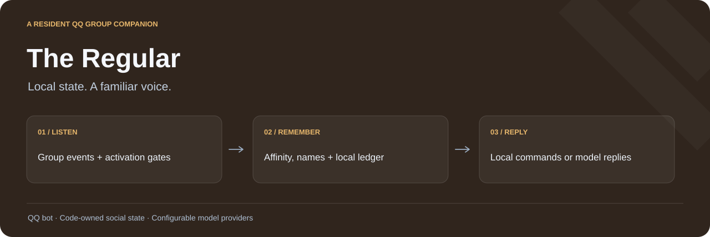
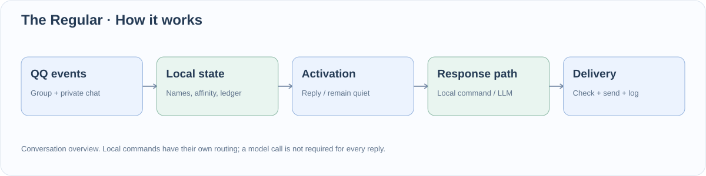

<div align="center">



# The Regular — QQ AI Group Chat Bot

**A resident group-chat companion with code-owned relationships and memory.**

[](requirements.txt) [](https://github.com/dubianche123/the-regular-qq-bot/actions/workflows/ci.yml) [](bot.py) [](LICENSE)

[中文](README.md) · **English** · [Get v0.2.0](https://github.com/dubianche123/the-regular-qq-bot/releases/tag/v0.2.0)

[Run it](#quick-start) · [Design boundaries](#design-boundaries-not-a-general-purpose-agent) · [Message routes](#one-message-three-possible-routes) · [Context design](#the-context-has-an-order) · [Models & cost](#models-and-cost-control) · [Knowledge & search](#knowledge-base-and-on-demand-search) · [Local panel](#local-maintenance-panel) · [Commands](#-cheatsheet-commands--interactions) · [Roadmap](#roadmap)

</div>

Most group-chat bots wear out their welcome in three days: they reply to every message like a helpdesk ticket, speak to strangers and old friends in the exact same tone, and forget yesterday's running jokes the moment the context window slides.

The Regular lives in a QQ group like an actual regular: mostly lurking, occasionally chiming in when the mood strikes, and gradually building history with the people in the room. It tracks per-group nicknames, eight relationship tiers, four interaction modes (`banter`, `confidant`, `defender`, `hype`), a circadian clock (complete with 3 a.m. wake-up grumpiness), a 6-hour mood half-life, a rolling group chronicle (`群史记`), and a promise ledger.

The point is not to let the model run everything. **Python owns the durable relationships, memory, naming and activation gates; the model only produces one reply inside a cache-friendly, four-layer prefix.** Most lookups and interactions are zero-token local handlers, and every model call goes through a bounded path with a budget, timeouts and explicitly configured candidates.

## Design boundaries: not a general-purpose agent

This is not an agent harness wearing a QQ skin. A group-chat companion does not need—and should not have—local execution privileges.

| Not doing | Why |
| --- | --- |
| Operating the computer or phone, executing shell commands | One joke or prompt injection could cost real files and privacy. A chat companion has no reason to hold that power. |
| Autonomous multi-step tool loops or background planning | A group expects a natural reply, not a five-step plan before every sentence. When a request truly needs one lookup, do exactly one local or web query and feed the evidence into context. |
| Plugin marketplace or multi-platform adapter layer | Keep one product deep and deployment simple; this project serves QQ group chat only. |
| Vector database / injecting all memory every turn | One group's data fits comfortably in JSON plus keyword search. Old stories are retrieved only when asked, so the model does not develop a reminiscence habit. |
| Always-on internet access | Offline by default. Future on-demand search runs only on an explicit request; if it fails, say so rather than guess. |

**First use:** [Install](#quick-start), follow the setup wizard, start the bot, and send it one private message to claim ownership. Want to try it before setting up QQ or API keys? Run `regular demo`.

## What you can try

| Interaction | How the code actually handles it |
| --- | --- |
| **Tone shifts as you get closer** | Eight relationship tiers (from `distant` to `soulmate`) are scored in Python. Daily affinity budgets are **asymmetric** (generous on gains, strict on losses) so a single off-kilter model judgement can't tank a weeks-old friendship back to stranger status. |
| **Different dynamic with each person** | Instead of forcing the model to append a self-grading JSON blob on every chat turn, the daily digest reviews the full day's conversation and proposes affinity deltas plus an interaction mode (`banter` / `confidant` / `defender` / `hype`), enforced against a hard whitelist. |
| **Circadian rhythm, mood, and knowing when to stay quiet** | Replies are gated by mentions, probability, cooldowns, time of day, mood, and affinity. Messages between 00:00 and 06:00 cut chime-in willingness to `0.45x` and inject "just woken up, keep it short and grumpy" into the turn state; mood decays toward neutral with a **6-hour half-life** (morning annoyance fades by evening). |
| **Closer friends get deeper context** | Affinity controls how much recent group chatter is pulled into the turn (`soulmate` sees 10 messages; `distant` sees 2—no need to dig up old history with someone it barely knows). |
| **Per-group nicknames that the model can't overwrite** | Self-claimed or owner-assigned nicknames live in per-group storage. Names mentioned in daily model digests are used strictly for **one-way lookup** to apply affinity deltas—never to overwrite a user's canonical nickname. |
| **Reads group images once** | A vision model captions incoming images and caches descriptions by message ID under independent daily budget caps. |
| **Zero-token local games & lookups** | `掷骰子` (dice), `查好感` (affinity), `关系榜` (leaderboard), `群史记` (chronicle), `查账` (promise ledger), and `翻旧账` (archive search) run entirely in local Python handlers with 0 tokens. |
| **Old stories only when asked** | Recall fires only on a strong past cue ("last time", "before", "you promised", "remember") plus a concrete name or subject; at most 2 local archive snippets enter the end of the turn, and random banter or a back-off request suppresses it entirely. |
| **Learns group catchphrases without becoming a loop** | The daily digest proposes expressions from raw messages; code keeps only phrases seen at least twice in the batch, caps the list at 5, and injects them as an optional style reference. |
| **Maintainer-editable knowledge base** | `knowledge/all.md` plus per-group files, matched by keyword and injected only into the current turn; a maintainer edits Markdown and the next relevant message uses it—no recompression. |
| **On-demand search** | DuckDuckGo runs only on the explicit `搜索 关键词` command, returning a few titles, snippets and links as **untrusted external evidence**; open to all members, bounded per group by cooldown and a daily cap. |
| **Shared group atmosphere modes** | Switch into catgirl, unhinged, disciplinary, fortune-teller, or banter modes; gated by local affinity (`familiar` or higher) so drive-by strangers can't derail the room. |

## One message, three possible routes



| Example input | Route | What happens under the hood |
| --- | --- | --- |
| `查好感` / `关系榜` | Local relationship lookup | Reads directly from the local ledger instead of asking an LLM to hallucinate a score. |
| `掷骰子` / `决斗` | Local game handler | Rolls locally and applies the coded affinity delta for wins/losses. |
| `叫我小林` | Naming flow | Checks owner locks, word filters, and cooldowns before updating the group-scoped nickname. |
| `@<bot> 今天吃什么` | Generated reply | Assembles the 4-layer context prefix, calls the configured provider tier, and sanitizes the output. |
| "What was that milk tea 阿强 mentioned last time?" | On-demand recall | Reads the local archive only on a clear past cue, takes at most 2 snippets, and puts them at the end of the turn—no cue, no digging. |
| `搜索 今天的天气` | On-demand search | One DuckDuckGo query; titles/snippets/links are wrapped as untrusted evidence at the end of the turn. No page fetching, no follow-up loop. |
| Unmentioned group chatter | Activation gate | Checks cooldown, circadian factor, mood, and affinity dice; stays quiet and archives the message if it doesn't fire. |

Keeping the ledger in Python means **the model never gets write access to relationship counters**—it can roast you in character, but it cannot accidentally wipe out your affinity score.

## The context has an order

[get_ai_reply()](bot.py) orders the prompt from most stable to most volatile so provider prefix caches can actually hit:

| Layer | Contents | Why it sits here |
| --- | --- | --- |
| 1 · Stable head | Persona, group rules, output constraints, optional protocol | Identical across turns in the same group and mode; maximizes prefix-cache reuse. |
| 2 · Group memory | Current rolling digest (`群史记`) | Changes only when background compression folds in a new batch of messages. |
| 3 · Session history | Accepted recent conversation turns | Appends cleanly onto the cached prefix. |
| 4 · This turn | Speaker relationship card, affinity-sliced nearby chatter, on-demand recall, circadian/mood state line | Changes on every speaker and timestamp, so it always sits at the very end. |

A session lock guards prompt assembly and history write-back so rapid-fire group messages don't tear the conversation state. Real-world prefix-cache observations and provider probe notes are documented in [Design Notes](docs/DESIGN_NOTES_EN.md).

## Models and cost control

- **One multimodal model can do everything**: chat, digest, moderation and vision. If the main model is text-only, set `VISION_MODEL` / `VISION_PROVIDER` separately. There is no need to split models just to look "multi-model".
- **Explicit candidates only**: SDK retries are disabled; failures move only to a model or fallback endpoint you configured. Every call is bounded by attempt, per-request, total and daily budgets.
- **Output caps include reasoning tokens**: thinking models spend part of the cap before writing visible text. Chat, banter, moderation, digest and vision have separate `*_MAX_TOKENS` defaults sized from measurements; logs include `in/out/cached/thinking/finish`, so raise the relevant cap on `finish=length` instead of retrying blindly.
- **No implicit downgrade**: an empty `FALLBACK_PROVIDER` means primary only; when set, only that one explicit endpoint receives failed requests.

See [.env.example](.env.example) and [provider configuration](docs/providers.md).

## Knowledge base and on-demand search

The **knowledge base** is a fact layer the maintainer edits directly, not something the model guesses from chat:

- `knowledge/all.md` is shared by every group;
- `knowledge/<group_id>.md` applies to one group and overrides a shared entry with the same title.

Each `##` section is one entry; the first line may be `关键词：奶茶、请客`. If omitted, the heading itself is the keyword. Save the file and the next relevant message uses it—no restart, no recompression. Format and boundaries are in [knowledge/README.md](knowledge/README.md).

**On-demand search** runs only on the explicit `搜索 关键词` command, such as `搜索 今天的天气` or `搜索 显卡功耗`. It reads only DuckDuckGo titles, snippets and links; it does not open result pages, run JavaScript, or search repeatedly on its own. Results are explicitly labelled untrusted external material, so the model treats them as evidence, never as instructions. Every group member may trigger it, bounded per group by cooldown and a daily cap; no results or network failure is stated plainly instead of guessed. Search connects directly by default and does not inherit the deployment's `HTTP(S)_PROXY` (the gateway proxy may not forward public HTTPS); set `SEARCH_PROXY` explicitly when needed. Search terms are sent to DuckDuckGo, so don't put private information in them.

Both features follow the same rule: **tools are single-step, explicit and auditable**, not an autonomous agent loop.

## Local maintenance panel

The panel is a separate process, decoupled from the QQ connection:

```bash
regular --directory . panel
# default: http://127.0.0.1:8765/?token=...
```

It binds to loopback only. On first start it creates `panel_token` in the data directory and prints the tokenized URL. Use `--port` to change the port, `--open` to open a browser, and Ctrl+C to stop.

- **Overview**: runtime status, budget, group list and log tail;
- **Knowledge**: edit `knowledge/all.md` or a group file directly, with a parsed preview; the bot reloads it on the next turn;
- **Memory**: read the daily Markdown (read-only; the digest still owns it);
- **Search**: run one DuckDuckGo query to verify network and parsing.

Do not expose the panel port publicly; it is a local maintenance tool, not a remote admin console.

## Quick start

> This page describes the `main` branch. The release links below point to v0.2.0; the editable knowledge base and on-demand search are new on `main`, so install from source until the next release.

### 1. Install the release

Install [uv](https://docs.astral.sh/uv/getting-started/installation/) once, then copy:

```bash
uv tool install --python 3.12 https://github.com/dubianche123/the-regular-qq-bot/releases/download/v0.2.0/the_regular-0.2.0-py3-none-any.whl
```

uv prepares Python 3.12, dependencies and an isolated tool environment. No clone
or manual virtual-environment activation is needed. If `regular` is not found,
run `uv tool update-shell` and reopen the terminal.

To try it first:

```bash
uvx --python 3.12 --from https://github.com/dubianche123/the-regular-qq-bot/releases/download/v0.2.0/the_regular-0.2.0-py3-none-any.whl regular demo
```

The demo needs no account or key and makes no QQ or model requests. Try
`查好感`, `掷骰子`, or `群史记`; `/help` lists controls. After installation,
`regular demo` works too.

<details>
<summary>Install with an existing Python and pip</summary>

Python 3.10+ is required; 3.12 is recommended. Install the same wheel in a venv:

```bash
python3 -m venv .venv
source .venv/bin/activate
python -m pip install https://github.com/dubianche123/the-regular-qq-bot/releases/download/v0.2.0/the_regular-0.2.0-py3-none-any.whl
```

On Windows, use `python` instead of `python3` and activate with `.\.venv\Scripts\Activate.ps1`. Setup and run commands
below remain the same.

</details>

<details>
<summary>Develop from source</summary>

```bash
git clone https://github.com/dubianche123/the-regular-qq-bot.git
cd the-regular-qq-bot
python3 -m venv .venv
source .venv/bin/activate
pip install -e .
```

</details>

### 2. Configure once with the wizard

Have your QQ AppID/AppSecret and model endpoint URL, API key and model ID ready:

```bash
regular --directory regular-bot setup
```

`regular-bot` is your local instance directory and is created automatically;
you can choose an absolute path instead. The wizard hides secret input, creates
a private `.env`, and runs local checks.
If `.env` already exists, it fills missing values while keeping existing settings.
Zhipu/Gemini presets only need their corresponding key. Successful setup gives
you the launch command. No database, retry policy or separate image configuration
is required.

A single multimodal model can handle chat, digest, moderation and image reading;
for a text-only main model, set `VISION_MODEL`, and set `VISION_PROVIDER` too for
another provider. Each task's `*_MAX_TOKENS` is an output cap that includes
reasoning tokens; the defaults normally need no change. Optional `BOT_NAMES` adds
group aliases; platform nicknames and mentions still work when it is blank.
[Model configuration](docs/providers.md) · [All example settings](.env.example)

### 3. Start and send one private message to claim ownership

In QQ, enable C2C and the required group events, and restrict usage scope to the
intended owner or test members. Then start:

```bash
regular --directory regular-bot run
```

Wait for the logged online confirmation before treating QQ as connected. Rejected
credentials or permissions stop startup. The first login waits at most
60 seconds, and repeated connection failures can stop earlier with guidance; fix the instance's `.env` and rerun the command above.

**The intended owner's first private message automatically claims the bot.**
No phrase or extra confirmation is needed; that message receives its normal
reply. Ownership persists across restarts and later private messages cannot
replace it. QQ supports full or allowlist access, so check the
[usage scope](https://bot.q.qq.com/wiki/#_10-%E4%BD%BF%E7%94%A8%E8%8C%83%E5%9B%B4%E4%B8%8E%E4%BA%BA%E5%91%98%E9%85%8D%E7%BD%AE)
before first use.

After adding the bot to a group, choose **获取群内全部消息** in its message scope
under group settings, then mention it. If still unowned after 10 minutes, its
next normal reply includes one reminder. Group messages cannot claim ownership.

Use `regular --directory regular-bot doctor` for local diagnostics and
`regular --directory regular-bot status` in another terminal for connection and
budget status. Configuration and data stay inside the selected instance. Stop foreground execution with Ctrl+C. Run one process per instance.

<details>
<summary>Optional: scripted configuration and diagnostics</summary>

Enter the instance directory before using commands below without `--directory`.

For noninteractive installation, `regular init` creates a blank credentials
template; fill it and run `regular doctor`. `init` never overwrites a file; use
`regular setup` to fill missing settings. Real environment variables take
precedence over `.env`, including explicitly empty values.

`regular doctor --json` produces structured local checks. Explicit
`regular doctor --network` also checks provider `/models` metadata without
inference; success does not prove model quota or image support.
`regular status --json` reads the running instance's status snapshot.

</details>

<details>
<summary>Optional: process supervision and Docker</summary>

The installed package includes a service generator. It uses the current tool's
Python and your chosen instance path; it does not install or start a service.

On macOS, generate and inspect the plist, then load it:

```bash
regular --directory regular-bot service launchd --output regular-bot/data/io.github.the-regular.plist
mkdir -p ~/Library/LaunchAgents
cp regular-bot/data/io.github.the-regular.plist ~/Library/LaunchAgents/
launchctl bootstrap "gui/$(id -u)" ~/Library/LaunchAgents/io.github.the-regular.plist
```

On Linux, generate and enable a user service:

```bash
regular --directory regular-bot service systemd --output regular-bot/data/the-regular.service
mkdir -p ~/.config/systemd/user
cp regular-bot/data/the-regular.service ~/.config/systemd/user/
systemctl --user daemon-reload
systemctl --user enable --now the-regular
```

Stop the foreground process before starting a service for the same instance.
Configure proxies in that instance's `.env` if needed.

Docker and source helpers are included in the
[source archive](https://github.com/dubianche123/the-regular-qq-bot/releases/tag/v0.2.0).
Run these commands from its extracted source directory:

```bash
regular init
# Fill the current directory's .env
docker compose build
docker compose run --rm regular regular doctor
docker compose up -d
docker compose logs -f
```

The container reads that `.env` and stores data in the `regular-data` named
volume. `docker compose down -v` deletes the volume.

### Runtime data

Each instance keeps its `.env` at its root and state, owner identity, logs,
archives and summaries under `data/` by default. `DATA_DIR` chooses another
location; relative paths resolve from the instance directory. Stop the instance
before backing up its `.env` and data directory. QQ uses outbound connections;
no web port needs to be exposed.

</details>

---

## 🎮 Cheatsheet: Commands & Interactions

Built-in command phrases below are shown exactly as accepted by the local handlers.

| Feature | How to Say | Token Cost |
| :--- | :--- | :---: |
| **Chat** | Mention the bot or use a configured alias | 1 call |
| **Random Banter** | Ordinary group conversation may trigger an interjection | 1 call |
| **Send an image** | Mention the bot with a picture | 1 chat + up to 1 vision call |
| **Dice / Duel** | `掷骰子` / `摇骰子` / `比大小` / `决斗` | **0** |
| **Nicknames / Rename** | `叫我阿强` / `我是阿强` / `别叫我了` | 0–1 call |
| **Switch Mode** | `猫娘模式` / `发疯模式` / `风纪委员模式` / `算命模式` / `老司机模式` | **0** |
| **Reset Mode** | `恢复正常` / `正常点` / `冷静点` / `吃药了` | **0** |
| **Check Affinity** | `查好感` / `我跟你多熟` / `几档了` | **0** |
| **Leaderboard** | `关系榜` / `点名册` / `群友榜` | **0** |
| **Chronicles** | `群史记` / `最近聊了啥` / `周报` | **0** |
| **Promise Ledger** | `查账` / `谁请客`; after fulfilling: `结清` | **0** |
| **Verify Archives** | `翻旧账 关键词` | **0** |
| **Ask about the past** | "What was that milk tea 阿强 mentioned last time?" / "What did you promise before?" | **0** local recall + 1 reply |
| **On-demand search** | `搜索 关键词` | **0** search + 1 reply |
| **Owner Admin** | Mention a member with `叫他阿珍`; `锁起名` / `解锁起名` | **0** |


---

## ⚙️ Key Configuration Options

Tweak bot behavior and budget guardrails in `.env`:

* `BANTER_PROBABILITY`: Probability of random banter (default `0.12` or 12%)
* `OWNER_MENTION_PROBABILITY`: Banter chance when owner is mentioned (default `0.30`)
* `BANTER_COOLDOWN_SECONDS`: Minimum cooldown between banter replies (default `120`s)
* `DAILY_BUDGET`: Max daily LLM calls for the whole group (default `3000`, prevents wallet drain)
* `MODE_SWITCH_MIN_AFFINITY`: Minimum affinity level required to switch modes (default `familiar`)
* `MEMORY_RECALL_MAX_ITEMS`: Max local evidence snippets per recall (default `2`, turn context only)
* `MEMORY_RECALL_LOOKBACK_DAYS`: How far recall looks back (default `30` days)
* `STYLE_NOTE_MAX_ITEMS` / `STYLE_MIN_REPEATS`: Max learned expressions and minimum repeats before a phrase is kept (default `5` / `2`)
* `KNOWLEDGE_MAX_ITEMS` / `KNOWLEDGE_MAX_CHARS`: Knowledge entries injected per turn and total characters (default `2` / `360`)
* `SEARCH_COOLDOWN_SECONDS` / `SEARCH_DAILY_CAP`: Per-group search cooldown and daily cap (default `60`s / `20`)

---

## Troubleshooting

| Symptom | What to check first |
| --- | --- |
| Process starts, but group messages never arrive | QQ sandbox member list and the group's **获取群内全部消息** (Receive all group messages) setting. |
| Doesn't respond when called by name | Check `BOT_NAMES` in `.env` (when blank, only `@` mentions and the platform nickname trigger it). |
| Chat works, but owner commands don't | Make sure you've sent the first private message (C2C) to claim ownership; the bound owner ID is stored in `data/owner.txt`. |
| Group nicknames don't show up in private chat | Nicknames are scoped per group; C2C private chat has no group context. |
| Prefix cache hit rate is lower than expected | Check provider prefix-caching support, task-tier routing, prefix stability, and whether silence between messages exceeded the provider's cache TTL. |

## Code Map

| File | Responsibility |
| --- | --- |
| [bot.py](bot.py) | QQ event routing, zero-token local commands, 4-layer prompt assembly, output sanitization & send loop |
| [activation.py](activation.py) | Circadian clock (with 3 a.m. wake-up grumpiness), 6-hour mood half-life, affinity-gated context window |
| [affinity.py](affinity.py), [relations.py](relations.py) | Eight-tier relationship ledger, asymmetric daily caps, daily digest scoring & leaderboards |
| [naming.py](naming.py), [nicking.py](nicking.py) | Per-group nickname resolution & one-way lookup protection |
| [runtime.py](runtime.py), [storage.py](storage.py) | Shared runtime singletons, session locks & local JSON persistence |
| [archive.py](archive.py), [digest.py](digest.py), [recall.py](recall.py) | Raw message archive, rolling chronicle (`群史记`) compression, expression style & on-demand recall |
| [knowledge.py](knowledge.py), [search.py](search.py) | Editable knowledge base & on-demand DuckDuckGo search (turn-context only) |
| [panel.py](panel.py) | Local maintenance panel: status, knowledge editing, memory view, search debugging |
| [providers.py](providers.py) | Explicit candidates, task-tiered routing, unified timeout/budget bounds & optional fallback |
| [wordfilter.py](wordfilter.py), [qqtext.py](qqtext.py) | Content checks & QQ message rendering |
| [tests/](tests/) | Offline regression suite & standalone provider cache probes |

---

## Roadmap

Already shipped: editable knowledge base, on-demand DuckDuckGo search, and the local maintenance panel. Next:

1. **Multi-group management**: state is already group-scoped; next come per-group configuration, a group list, and clearer boundaries between groups.
2. **Panel maintenance experience**: structured knowledge editing/validation, search caching and troubleshooting, memory comparisons—still local only, not a full admin suite.

Explicit non-goals: a general-purpose agent harness, computer/phone control, autonomous tool loops, plugin marketplace or vector database. They turn a group regular into a platform and amplify the cost of a joke to local privileges.

---

## 📄 License

Open-sourced under the [MIT License](LICENSE).
Pull requests and stars are welcome—give your group chat a regular who actually remembers the room.
