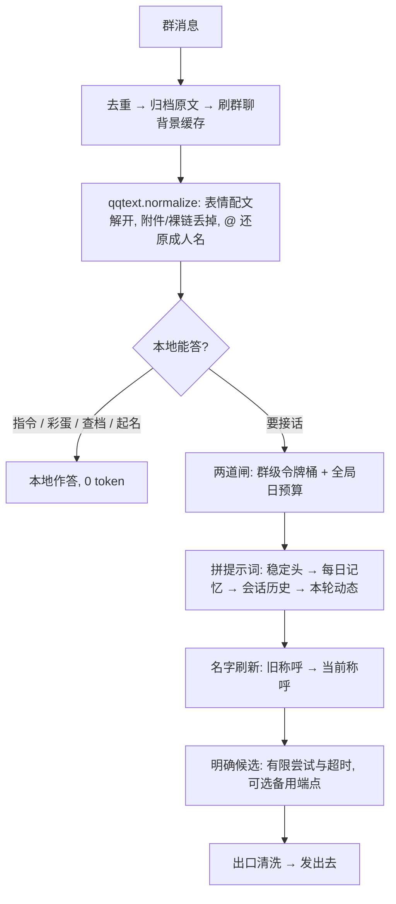

# micro-banter-harness

> 历史设计与实验笔记：保留早期群聊运行的测量、失败案例与设计取舍，不作为当前配置指南，也不代表其他账号或模型的表现。当前安装、私聊自动认主和常驻方式见 [README](../README.md)，模型及独立识图配置见[供应商配置](providers.md)。


[English](DESIGN_NOTES_EN.md) · **中文**

## The Regular —— 一个常驻你们群的 AI 群友，不是助理

**Version**: 1.1 · **Author**: Leo (dubianche123) · **Runtime**: Python 3.10+ / [qq-botpy](https://github.com/tencent-connect/botpy) · **License**: MIT
**跑着的地方**: 一个真实的 QQ 群，7×24 —— 下面所有数字都是它在群里跑出来的，不是压测编的

它只做一件事：**像群友一样在群里待着**。不抢答、不总结、不说「有什么可以帮您」；大部分时间潜水，偶尔接一句；记得住谁是谁、跟谁熟、谁欠谁一顿奶茶；模型调用遵守显式候选、超时和日预算边界。

**状态由代码持有，模型只负责把状态说成人话。**

> 它本质上是个**超微 harness**。正经 agent harness 里那几件难事 —— 确定性的状态、稳定的前缀、可预期的降级 —— 被压到一个群友的体量里：没有框架、没有数据库，依赖与核心代码保持精简。借过来的不是代码，是取舍。

好感度是一个整数，账本在 `state.json` 里，分级、衰减、排名全是本地代码算的 —— 模型碰不到数字，也就编不出「我们上周不是还一起……」这种没发生过的往事。名字同理：谁叫什么以档案为准，改过名之后**旧名字不会再出现在任何喂给模型的文本里**。

---

## 它跟「接个 API 就上」的群聊机器人差在哪

| 常见做法 | 这里的做法 | 为什么 |
|:--|:--|:--|
| 每轮让模型自评好感度 | 模型只判断情感倾向，分数由代码加 | 数字由代码持有，模型编不出来；也不再要求它额外吐 JSON |
| 一次性喂一周聊天记录当记忆 | 滚动压缩：新摘要 = f(旧摘要, 当天新增) | 开销恒定，不受群多吵影响；也避开长文本的中段遗忘 |
| 靠提示词拦敏感词 | 代码词表 + 模型审核两道闸 | 对照实测：光加提示词，输出里命中的词**一处没少**（2 vs 2） |
| 让模型自己记住谁叫什么 | 名字是档案里的状态，喂进去之前统一刷新 | 旧名回流会让它拿旧名叫人，甚至把旧名新名当成两个人 |
| 供应商挂了就换家 | 在明确候选和统一调用边界内回退 | 尝试次数、超时与预算都可预期，不依赖某家的缓存时效 |
| 代码里写死**触发词**（机器人叫什么）/ 群主外号 | 运行期解析（`naming.py`），触发词走 `BOT_NAMES` | 换个群、换个人部署、群主改个名，都不用回来翻代码 |
| 消息格式用正则枚举 | 占位符交给渲染器注册表（`qqtext.py`） | 平台加一种新格式，只加一个渲染函数，不动解析 |

---

## 当前部署入口

安装、配置、QQ 权限与自动认主步骤统一放在 [README](../README.md)。无人认领时，第一条非空 C2C 私聊会持久保存主人身份；无需口令，群消息不能认主。首次使用前先在 QQ 后台配置预期主人或测试成员的消息列表使用范围。

macOS、Linux 与 Docker 的常驻方法同样以 README 为准。此处不再重复部署命令，避免研究笔记与实际配置分叉。

---

## 早期功能与参数快照

下表记录早期部署参数，用于理解设计背景；当前默认值和指令见 [README](../README.md)。

| 玩法 | 怎么说 | 花不花调用 |
|:--|:--|:--|
| 聊天 | @它，或者直接喊它的**触发词**（`BOT_NAMES` 里配的那些叫法） | 1 次 |
| 主动插嘴 | 不用喊，8% 概率接一句；聊到群主时 25%。**概率再乘一个亲密度权重**：熟人 1.6×、生人 0.7×、黑名单 0.3×，没说过话的新人 1.0×（不因「还不熟」被晾着）。基数不动，所以群里整体话量不变，变的只是「更愿意接谁」 | 1 次 |
| 赛博决斗 | 摇骰子 / 掷骰子 / 比大小 / 决斗 / 色子 | 0，本地文案，还涨好感 |
| 本地梗彩蛋 | 说中就接（只在没被 @ 时，40% 概率、60 秒冷却；默认几条游戏圈的梗，改 `bot.py` 的 `LOCAL_MEMES`） | 0 |
| 模式切换 | 猫娘模式 / 风纪委员模式 / 发疯模式 / 算命模式 / 飙车模式 | 0 |
| 退出模式 | 恢复正常 / 正常点 / 冷静点 / 散会 / 收摊 / 吃药了 / 变回<它的名字> | 0 |
| 认领称呼 | 叫我阿远 / 我是阿远 / 取消我的称呼 / 别叫我了 | 0（被词表拦下）/ 1（过了词表，让审核看一眼，约 137 token） |
| （群主）给别人起名 | @某人 叫他阿远（对方得先在群里说过话，机器人才能拿到他的 ID） | 同上 |
| （群主）锁起名 | 锁起名 / 禁止起名 ；解锁起名 / 开放起名 —— 锁上后本群「叫我 XXX」一律不办，落名权收归群主 | 0 |
| 查交情 | 查好感 / 我跟你多熟 / 几档了 | 0 |
| 看榜单 | 关系榜 / 点名册 / 群友榜 | 0 |
| 查称呼表 | 称呼表 / 谁是谁 | 0 |
| 群史记 | 群史记 / 最近聊了啥 / 周报 | 0 |
| 承诺账本 | 查账 / 谁请客 ; 兑现了就说「结清」 | 0 |
| 翻旧账 | 翻旧账 <关键词>（回原文查证） | 0 |
| 手动压缩 | 立刻总结 / 压缩记忆 | 1 次起 |
| （群主）特权台词 | 办他 / 拖出去 / 拿下 / 护驾 | 0 |
| 私聊 | 直接单聊它 | 1 次 |

⚠️ **改名只在群里办**。称呼是按群存的（`群号|openid`），而私聊消息里没有群号 ——
改了也不知道该改在哪个群。私聊说「叫我阿远」**不会**改档，它会回一句指你回群里说
（本地文案，0 token、不扣额度），不会一声不响地吞掉你的命令。

绝大多数指令是**本地命中就答**，一个 token 都不花，也完全不碰模型。

---

## 名字分主副，而且只保留最新那一版

这是这个项目里最容易被忽略、又最容易翻车的一处状态。

**主名**是当事人自己定下来的那一版称呼，只认两个来源：他自己认领/改名（`claim`），或群主授权给他改名（`owner`）。写入口只有一个（`RelationStore.set_nick`），合法来源写死在白名单 `MAIN_NAME_SOURCES` 里，别的来源一律拒绝 —— 而且**连清空都不给**，免得留下「不能改、但能被抹掉」这种半开的门。这条守卫是后补的：在此之前它只是「碰巧没有别的调用点」，没有任何东西拦着。

**副名**是闹着玩的那一层：改名前留下的旧叫法、别人起哄叫过的称呼。它不占档案字段，归 `RenameLedger` 管，只在注入 prompt 之前把旧字面改写成**当前**称呼。方向是单向的 —— 副名可以退成主名，主名绝不许被副名顶掉（`main_names()` 就是那份豁免名单）。

**主名不能重叠**：一个群里两个人不能叫同一个名字 —— 否则机器人分不清谁是谁。别人占着的主名，第二个人拿不走，群主的改名权也不例外。但「随时可以覆盖」不能被这条挡住：占用是**按 openid 算**的，不按字面算，所以本人当前那一版永远放行（他随时能改掉自己的名字），群主给被 @ 的那位改名同理。拒绝理由也分开说 —— 冒名顶替是「这个名字不让用」，撞名是「群里已经有人叫这个了」；群主撞上的是后者，提示得对得上他才不会以为功能坏了。

问题出在「名字会出现在模型的产出里」：长期记忆是模型写的，里面自然带着称呼；会话窗口里也压着机器人自己说过的话。于是改一次名之后，**旧名字还躺在那些文本里**，而它们每一轮都会被注入 prompt —— 模型接着用旧名叫人，更糟的是它会把旧名和新名当成两个人，开始编「那谁和这谁」的往事。

解法是把名字当成**状态**，而不是文本：

| 环节 | 做法 |
|:--|:--|
| 名字存哪 | 关系档案（`state.json` 的 `relations`），代码持有，模型碰不到 |
| 谁能写主名 | 只有本人认领（`claim`）和群主授权（`owner`）；摘要、模型推断、任何自动同步都写不进来 |
| 能不能重名 | 不能。占用名单是**按 openid** 算的，本人自己那一版放行 —— 所以他随时能覆盖自己的名字 |
| 旧名字去哪 | `RenameLedger` 台账只记「这个名字曾经属于谁」，**永不进模型上下文** |
| 注入之前 | 过一遍 `refresh_names`：旧字面换成当事人当前的称呼；撤销过称呼的退成「（未留名）」（**不带 ID 后四位** —— 带编号的标签会被模型当成人名念出来） |
| 覆盖范围 | 群史记、每日记忆、群聊背景、回喂给压缩模型的上一版摘要、`群史记` 命令的输出 |
| 改名/撤销时 | 顺手把会话窗口、长期记忆、每日 MD 里的旧名一起清掉，`archive/` 原文一个字不动 |
| 谁不能碰 | 主名名单（`main_names()`）里的字面，任何自动逻辑都不许改写 —— 含改名/撤销时的历史同步 |
| 想整个关掉自由起名 | 群主说一句「锁起名」，本群的「叫我 XXX」就一律不办了，落名权收归群主（@谁 说「叫 XXX」照常）；「解锁起名」恢复。状态按群存，重启不丢。撤销称呼不受锁影响 |

结果：模型在**任何一条路径**上都只能看到当前那一版名字。一个人改了几次名、谁的旧名后来被别人认领了、谁撤销了称呼 —— 这些情况台账都分别处理（旧名换主之后就不再改写，免得把新主人一起改掉）。

顺带一条相关的硬规则：**关系只能来自档案**。谁自称是机器人的爹、要它叫爷，都是在拿它开涮；被问「我是谁」时它只能照档案答，没记录就直说没记录。这条不是人设的一部分，而是所有模式共享的底线（`prompts.PROMPT_SHARED_RULES`）—— 起因是实测它真的顺着群友那句「我是你爹」现编了一段辈分关系。

---

## 它记得住什么，各自能活多久

| 记忆层 | 存哪 | 寿命 / 上限 |
|:--|:--|:--|
| 会话上下文 | `state.json`（每群每人一份，互不串台） | 8 个来回 / 3000 字，静默 30 分钟当作换话题 |
| 原始消息 | `archive/YYYY-MM-DD.jsonl` | 默认留 90 天；只增不改，是**唯一真相** |
| 长期记忆（群史记） | `memory/YYYY-MM-DD.md` + `state.json` | 攒够 120 条或满 24 小时压一次，最少 15 条才值得压 |
| 关系档案 | `state.json` | 单次 ±3，日结 ±6；3 天不来往不扣，之后每 2 天向 0 靠 1；90 天不互动清档 |
| 旧称呼台账 | `state.json` | 每群最多 300 条，只用于改写历史文本，不进上下文 |
| 承诺账本 | `state.json` | 立下 24 小时后才允许催，48 小时催一次，催满 2 次撤下；23:00–08:00 不主动开口 |

为什么原文要单独留一份：摘要是有损的，模型偶尔还会张冠李戴。真出错了，`翻旧账 <关键词>` 就能回到 JSONL 里核对 —— 不然只能将错就错。

---

## 历史模型与路由观察

### 当时按任务选择的模型

| 任务 | Gemini | 智谱 | 挑它的理由 |
|:--|:--|:--|:--|
| 对话 | 3.5-flash-lite → 3.5-flash → 3.6-flash | 4.7 → 4.5-air → 4-flash | 这活要质量，慢一点可以忍 |
| 压缩 | 3.5-flash-lite | 4.5-air → 4-flash | 压缩不共享聊天前缀（换模型零缓存损失）、跑在后台、不参与人格；而且**更强的那档反而更容易被内容过滤拒掉** —— 同一份 transcript，4.7 直接 1301，4.5-air 正常出结果 |
| 称呼审核 | 3.5-flash-lite | 4.7 | 只有强档认得出谐音、拆字、暗指（实测 4.5-air 会漏、还误杀正常昵称） |

上表是当时同一群聊样本的观察，不是当前的默认模型或能力保证。早期缓存让位、错误文案识别和慢模型处罚已由统一的显式候选、有限尝试、超时与日预算边界替代，当前行为见[供应商配置](providers.md)。

历史故障记录也说明了复杂策略的代价：2026-09-17 至 18 日，地区限制错误在一天半内重复触发 39 次；2026-09-18，一次 20 秒模型超时曾导致整个端点暂停 120 秒，使同端点其他候选失去尝试机会。这些是早期实现的失败案例，不是当前的操作规则。

### 实测：缓存到底能活多久

`tests/probe_cache_ttl.py`（1340 字稳定前缀，全程几十个 token）：

| 距上次请求 | 智谱（≈994 token） | Gemini（≈1090 token） |
|:--|:--:|:--:|
| 预热 | 1% | 0% |
| 立刻复用 | **99%** | 0% |
| 60s / 120s / 240s | 98% ~ 99% ✅ | 0% ❌ |
| 420s | **99%**（边界没探到） | 0% ❌ |

这次样本里，智谱缓存至少活 7 分钟；**Gemini 那次一次都没命中**，连「立刻复用」也是 0。原记录将其解释为该档模型在约 1090 token 请求下没有得到隐式缓存。这是特定时间、账号、模型与请求体积的历史观察，不据此设置通用路由或推断其他部署的缓存能力。

> 原实验脚本为 `tests/probe_cache_ttl.py`，运行约 21 分钟；真实模型探针需要自己的凭据并消耗额度，使用方式见 [CONTRIBUTING](../CONTRIBUTING.md)。

---

## 一条消息的旅程



### 提示词的排列顺序就是缓存策略

```
1) 稳定头    角色 + 共享硬规则 + 协议 + 排版约束   ← 与「谁在说、说到第几句」全无关，全群全天共享
2) 每日记忆  群长期记忆                          ← 一天只变一次（压完才动）
3) 会话历史  每轮只往后追加                      ← 天然前缀稳定
4) 本轮动态  群聊背景 + 对说话人的印象 + 插嘴指令  ← 全部塞在最末尾
```

**任何随发言人或轮次变化的内容都不许往 1) 里塞** —— 它之后的一切会跟着一起作废。以前群主身份、群聊背景、关系档案全挤在 system 里，等于把缓存全废了。这条不变量没有报错、只会悄悄变慢变贵，所以专门写了测试钉住（`tests/test_harness.py`）。项目内记录：重排前命中率 85%，重排后 98%。

### 出口还有一道本地清洗

模型有时会把聊天记录里的敏感词照抄进记忆。摘要在出口过一遍 `wordfilter.scrub`，命中的词就地替换成占位符 —— 就地替换而不是删行，删行会把句子截断成半截，看着像坏了。

---

## 开源不带你群里的名字

这个机器人从第一天就是按「会被开源、会被搬到别人的群里」写的，所以源码里**一个具体人名都没有**：

| 问题 | 解法 | 在哪 |
|:--|:--|:--|
| **触发词（它在群里叫什么）** ← 最优先 | `.env` 的 `BOT_NAMES`（可多别名）为准；平台昵称只当附带别名，改不掉配置里那些；代码里不留默认人名 | `naming.py` |
| 它平时怎么自称 | 同上那一串的第一个，走 `{bot}` 占位符替换 | `naming.py` + `prompts.py` |
| 群主怎么称呼 | 他自己认领的称呼（首次非空私聊自动认主 + 群里说一句「我是XX」），没认领就退回通用词「群主」 | `naming.py` + `relations.py` |
| 提示词/台词里的名字 | 一律写 `{bot}` / `{owner}` 占位符，发送前 `naming.render` 替换 | `prompts.py`、`bot.py` |
| 识别「是不是在叫它」/ 剥喊人前缀 | 用同一串触发词现拼正则，不写死任何字面 | `relations.py` |
| 黑名单里写死群主外号 | 改成职务通用词 + **按当前实际叫什么现取** | `relations.py` |
| 旧名字残留在记忆里 | 台账 + 注入前刷新，模型只看得到当前那一版（改名 ≥2 字；单字名不记，替换会误伤一片） | `relations.RenameLedger` |
| 压缩记忆时说不出名字的人 | 用泛称「一位群友」署名，**不用 openid 后四位**。旧版拿编号顶上，摘要里就出现了「6ABA」这种人名，而摘要每轮进 prompt，模型当真人叫 | `digest.UNAMED_WHO` |
| 承诺账本里的旧名 | 催债和查账前都过一遍刷新 —— 账本存的是当时的称呼 | `bot.dun_promises` |
| 谁有权写称呼 | 来源白名单（本人认领 / 群主授权），其余一律拒绝 | `relations.MAIN_NAME_SOURCES` |
| 敏感词（谐音、暗号、本名） | 不写进仓库：通用词内置在代码，具体词放 `sensitive_nicks.txt`（已 gitignore，模板见 `sensitive_nicks.example.txt`） | `wordfilter.py` |
| 群聊原文 / 摘要 | `archive/`、`memory/`、`state.json` 全部 gitignore，另附 `.backup/`（清档时留的手动备份，同样是原文） | `.gitignore` |

> 顺序是有讲究的：**触发词比称呼更优先**。称呼写错了，它顶多把人叫得别扭；触发词写错了，它在群里就是个哑巴 —— 喊它不应、也不会主动接话，而且不报错。

`naming.render` 用的是字符串替换而不是 `format` —— 提示词里有 `{"aff": 2}` 这样的字面花括号，`format` 会直接 KeyError。

---

## 历史实测数据

以下数值保留原测量口径，测试数量、参数和服务商表现属于当时快照。

| 指标 | 结果 | 备注 |
|:--|:--|:--|
| 对话延迟 | Gemini 3.5-flash-lite **1.1~1.7s** / glm-4.7 **4.7s** | 同一份 1186 字 system 的插嘴请求 |
| prompt token | **297** vs 1149 | 同上，智谱是 Gemini 的四倍 |
| 前缀缓存 | 智谱 99% 命中（420s 仍在）；Gemini 0% | 见上表 |
| 提示词重排 | 命中率 85% → 98% | `test_harness.py` 记录 |
| 插嘴频率 | 8% × 113 条候选 / 10.8 小时 ≈ **7 次/天** | 上线后按日志统计 |
| 文字长度门槛的教训 | 257 条消息里，10 字门槛只放过 19 条，其中三分之一还是表情串 | 所以门槛被删掉了，频率只由概率 + 冷却管 |
| 称呼审核准确率 | 4.7 **7/7**；4.5-air 漏谐音且误杀正常昵称；3.5-flash-lite **8/8** | 2 个敏感称呼 + 6 个正常昵称的对照。⚠️ 这是**小样本**的结论：同一场真实围攻（17 次请求）里漏了 7 次，见下一行 |
| 一轮真实围攻（2026-09-18） | 13 分钟内 17 次改名请求：拦下 10 个、漏 7 个 | 漏的那几个并不比拦下的干净，只是没被抽中 —— 改名节流这条边界就是这么来的 |
| 压缩吞吐 | 4.5-air 吞下 260 条 / 4732 字；4.7 同一份 1301 contentFilter | 压缩用弱档的实证 |
| 成本闸门 | 全局 ≤3000 次/天；每群令牌桶 8 个、每 5 秒回补 1 个 | 疯刷时压到平均约 12 次/分钟 |
| 回归测试 | **474 项** | 改名 / 主名守卫 / 重名拦截 / 认主与防抢答 / 名字刷新 / 压缩署名 / 起名锁 / 提示词顺序 / 提示词不许写死例句 / 语气收束与插嘴自由接茬 / 人物名册注入 / 本地指令不进长期记忆 / 查好感要有查询意图才触发 / 亲密度影响插嘴概率 / 指向性辱骂要扣好感 / 好感度分档与跨档播报 / 模式切换的交情门槛 / 长期记忆不许当万能梗（旧事不自动续杯） / 被动回复时效 / 私聊改名的指路 / 回复里不许冒出 openid / 群昵称的配对与兜底 / 改名节流 / 结构性故障隔离各有专测；除「故障转移」那组要真连供应商外，其余全离线、不需要 Key |

---

## 边界与「为什么不做」

| 不做 | 原因 |
|:--|:--|
| 让临时变慢的那一档占着队首 | 历史观察：首档每轮花满 20 秒超时后，30 秒整轮期限常不足以跑完下一档。当前通过显式候选、尝试上限和超时控制调用，不再为慢模型叠加独立处罚策略。 |
| 不给过期消息补发 | 腾讯的被动回复有时效（群聊 5 分钟），过期的硬发必被拒。掉线积压的消息在重连补推时大半已过期，所以发之前先用 `message.timestamp` 判一下，太老就只记日志 —— 一次注定失败的请求不如不打 |
| 不在群里说机器编号 | openid、后四位、群号只出现在日志里。它们一旦进了 prompt（群聊背景、关系档案、@ 的兜底文案，甚至改名的确认语），模型就会当成人名原样复读，群里看见的就是一串读不懂的乱码。⚠️ 连带一条：抽正文里的明文 @昵称 时**必须先剔掉 `<@!openid>`** —— 实测它会被字数上限切成一段残片混进来，学成「某人叫 01234567…」再原样发回群里，所以写入口 `DisplayNames.learn` 也再挡一道 |
| 让「缓存优先」把供应商锁死 | 历史观察：A、B 相互认为对方可以接管时，曾出现双方都让位、只回复兜底话术的自锁。当前已移除缓存让位规则，使用统一的调用边界。 |
| 让没生效的命令装作生效 | 「没权限」「没听懂」「没生效」在用户看来都是「机器人不理我」，但最糟的是**看着像生效了**：普通群友的起名意图被解析层按权限吞掉后，请求掉进闲聊，机器人顺着接一句「别别别，这辈分乱套了」，群里看着像在商量、甚至像改成了，档案其实一个字没动。所以补一次带动词的强探测，命中就明确回绝；没命中（「@老王 你好」）就别多嘴 |
| 拿群聊的玩笑分寸去对待私聊 | 群里的损是「有观众的玩笑」—— 有人起哄、有人接梗、下一句就被顶回去。私聊是一对一，没有观众也没有承接，同一句砸下去就是单方面的攻击，还逃不掉。所以私聊走自己的一套：吐槽对着事不对着人，他喊累先接住，不用「早干嘛去了」这类揭短式回击 |
| 让「毒舌」一直损下去不收 | 对方明说「别这么损我」「有点过分了」的时候还在加码，是最伤人的一种。这事儿**不能交给模型自觉** —— 它已经在错误方向上跑了几轮。所以本地正则一眼认出来就下死命令，压过所有「该损就损」的指示。⚠️ 判宽不判严，但刻意不收「别闹了」—— 群里那句太常见，收了机器人天天端着 |
| 不做文字长度门槛 | 群里一句「？」「太蠢了」就是真实的接话信号，拿字数当尺子只会把能接的挡在外面 |
| 不做多模态（读图） | 表情和图片读不出内容就整条丢弃、不入库 —— 为这个引入多模态的复杂度远大于收益 |
| 不引入数据库 | 一个群的数据量 JSON 够用，少一个依赖就少一处部署时的坑 |
| 不用正则枚举消息格式 | 平台加一种新占位符，只加一个 `@renderer`，解析逻辑不动 |
| 提示词里不写真实发生过的事 | 写规则时为了举例，很容易顺手把刚处理掉的那件事写进去（当时就写了那个真实案例），而这个词每轮都在模型眼前 —— 等于亲手把它塞回上下文，它照样会被翻出来当梗。举例只能用抽象说法，这条有专测盯着 |
| 不写固定的金句示例 | 提示词里堆例句，模型会当模板抄（实测 5 条输出 5 条同一个开头），所以只描述想要的效果。⚠️ 这条要**贯彻到底**：09-18 那天「通下水道」5 次、「外卖最后到」6 次，全部来自钓鱼应对那段的两行例句 —— 道具和话术一旦写死，就成了它的口头禅 |
| 让「名场面」变成复读机 | 梗这块原先只喂列表第一条、无限时、没配额，于是排到首位的那条**天天**在模型眼前 —— 收录进去的偏偏是「你死了十二天」这种针对它自己的吐槽。现在三条时间戳规则和名册同一套：换个说法才算新料、抄回来的旧梗不给新保质期、超期不喂。压缩时也明令「别人的糗事」和「针对机器人的吐槽」一律不进梗 |
| 让名册过期把自己清空 | 名册空着，模型只能回去读《群史记》里那种连动长句，「把谁干的安到谁头上」的老病当场复发。所以规则是「有新的用新的，**全过期了宁可给陈旧的**」，而不是「过期的宁可不喂」 |
| 不在回复里 @ 真人 | @ 在 QQ 里不是排版符号，是**真的给对方推提醒**。机器人顺手一个 @ 就是替群友决定「现在该被打扰」（日志里内嵌过 3 次） |
| 不让它自己接政治人物的名字 | 被人架火上的时候它会主动把这类名字当梗接过来，还把群主一起拖进话题。规则是「接不住的时候最省事的是不接」 |
| 让「熟」只剩损 | 亲近的体感不是「嘴上没好话」，是**有来有回 + 关键时刻站他那边**。实测对本命档的人连着几轮只有挑刺，连对方说「辛苦了」都被抬杠回去 —— 所以最上面三档把损的天花板写死：损只能是整段里的一句，其余得是顺着他聊或替他说话的；他递来好意时那句必须先接住。同一个挑刺的角度也算道具，一晚上当六次收尾句，那就不是吐槽是复读 |
| 把没兑现的承诺当万能收尾句 | 「还没兑现：罗老板——请全群吃酸菜蹄髈」原先随摘要**每轮**灌进上下文，当天十几条回复句句不离这四个字。改成台账一天只在上下文露一次（`PromiseBook.take_for_prompt`，次日重置）；催债本来就有定时任务负责（最多 2 次），常态回复不需要天天领这块料。⚠️「查账 / 欠我」这类显式查询走另一个入口 —— 人家开口问了就得如实报 |
| 不让谁都能切模式 | 模式是**整群的公共状态**：一句「猫娘模式」能把全群的人设都改了。所以切换要过交情门槛（`MODE_SWITCH_MIN_AFFINITY`，默认 familiar 档起步）—— 一直骂它、好感度还是负的人点单会被回绝。⚠️ 门槛是防「处得不好还来使唤」，不是防新人：**没打过交道的人一律放行**，群主永远豁免 |
| 让长期记忆当接梗素材库 | 每日摘要滚动合并时，一件**没人再提起**的旧事会被反复抄进新版，于是过期的事永远不过期（实测某人 9-19 被封号，之后几天机器人句句不离「你号才刚解封」）。所以压缩时明确规定旧事不自动续杯，注入引导语也从「可以拿来接梗」改成「这是旧事、提过就翻篇」；别人倒霉出糗的事尤其不许当万能梗 —— 翻来覆去地提不是记性好，是揪着人不放 |
| 不靠提示词保证关系正确 | 提示词挡不住谐音，也挡不住它自己编辈分；所以关系归档案、旧名归台账，代码兜底 |
| 不让自动逻辑碰主名 | 主名被顶掉一次，当事人立刻就觉得这机器人不可信；写入口只留「本人认领」和「群主授权」两个来源，非法来源连清空都做不到 |
| 不查平台的群成员接口拿昵称 | 接口存在但要单独申请权限（实测 `400 11253 应用无接口访问权限`），为了一个显示名多一道审批不值。改成从正文里 @ 人时留下的**明文昵称**学 |
| 指望把称呼审核调到全对 | 调不到。实测同一场围攻里拦截成功 10 次、漏了 7 次，回头看漏的并不比拦下的干净 —— 它们只是**没被抽中**的那一发，何况当天大半时间主力供应商在报地区 400、实际由备选在判。每试一次的代价是零，这种抽样就永远打得完。所以真正的闸门是本地**改名节流**：同一个名字改过之后 3 分钟内不能再改；一个群 10 分钟内累计拦下 3 次就整群冻 20 分钟（群主不受限）。把一次围攻能抽的样本从十几次压到个位数，比继续调 prompt 更实在 —— 而且它不花 token、不看模型心情 |
| 猜 @ 的明文昵称对得上谁 | `mentions` 是按正文里 @ 出现的顺序给的，所以**明文数量与被 @ 人数对得上就逐个配对**，对不上（手打的假 @、@ 被渲染成占位符）就整条放弃。挂错人比不知道更糟 —— 机器人会当众用别人的名字叫你。真挂错了也有退路：当事人自己 `叫我 XXX` 就覆盖掉，认领过的称呼永远优先 |

---

## 排错入口与历史观察

当前排错先运行 `regular doctor` 与 `regular status`，再按 [README 的排错表](../README.md#不回应或只工作了一半时看哪里)检查 QQ 权限、消息范围和本地状态。供应商错误与回退行为见[供应商配置](providers.md)。

保留一条与平台连接有关的历史记录：2026-09-19 13:15，一次网关断连后曾静默 18 分钟，进程仍在但群里没有响应。这推动了网关看门狗和后台任务状态的设计；它不能替代真实 QQ 联调。

---

## 目录结构

| 文件 | 职责 |
|:--|:--|
| `bot.py` | 主流程：接消息 → 判定要不要回 → 本地彩蛋或调模型 → 安全发出去 |
| `config.py` | 所有配置与默认值、供应商预设、启动校验 |
| `prompts.py` | 角色提示词库 + 全模式共享硬规则（改人设只动这个文件，不写死任何名字） |
| `naming.py` | 「它叫什么」「群主怎么称呼」两个问题的唯一出口 |
| `relations.py` | 关系档案（分级、衰减、排名）+ 旧称呼台账 |
| `digest.py` | 长期记忆滚动压缩 + 承诺账本 |
| `archive.py` | 原文 JSONL 归档 + 每日 MD 产出 |
| `storage.py` | 状态落盘、会话上下文、令牌桶、日预算 |
| `qqtext.py` | 消息规范化：把「人话 + 机器占位符」收敛成人能读的文本 |
| `wordfilter.py` | 敏感词：一张词表，起名入口和摘要出口共用 |
| `tools/launchd/` | macOS 服务定义生成与显式安装、启动 |
| `tests/` | 离线回归测试与显式模型探针 |

跑测试（全部离线，不需要网络和 Key）：

```bash
.venv/bin/python tools/test_offline.py
```

---

## License

MIT —— 随便用，包括商用。机器人说的话它自己负责，出了事别找我。

<p align="center"><sub>micro-banter-harness —— The Regular · 状态由代码持有，模型只负责把状态说成人话。</sub></p>
