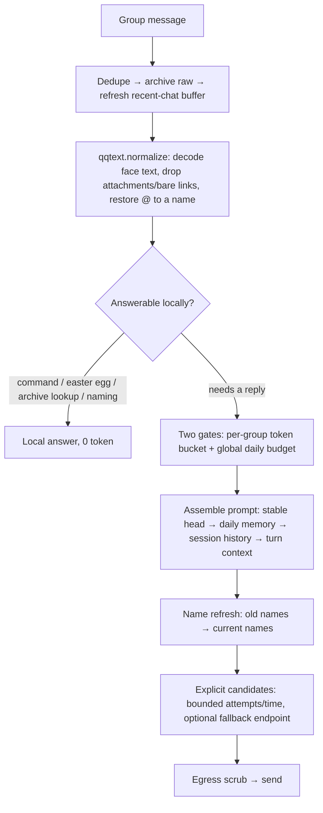

# the-regular-qq-bot

> Historical design and experiment notes: these measurements, failures and trade-offs describe an early deployment, not current setup instructions or a guarantee for other accounts/models. Use the [README](../README_EN.md) for installation, automatic private-chat ownership and services, and [provider configuration](providers.md) for model/image setup.


**English** · [中文](DESIGN_NOTES.md)

## The Regular — a resident AI member of your group chat, not an assistant

**Version**: 1.1 · **Author**: Leo (dubianche123) · **Runtime**: Python 3.10+ / [qq-botpy](https://github.com/tencent-connect/botpy) · **License**: MIT
**Where it runs**: one real QQ group, 7×24 — every number below was measured there, not benchmarked

It does exactly one thing: **it hangs out in the group like a member**. It does not race to answer, does not summarize, never says "how may I help you". Most of the time it lurks, occasionally it jumps in with one line; it remembers who is who, who it is close to, who still owes someone a bubble tea. Model calls follow explicit candidates, timeout and daily-budget boundaries.

**Code holds the state. The model only puts the state into words.**

> It borrows exactly three engineering trade-offs from agent harnesses — deterministic state, a stable prefix, predictable degradation — but has no tool loop and no local execution privileges. No framework, no database, just a small dependency and code footprint.

Affinity is an integer. The ledger lives in `state.json`; grading, decay and ranking are all computed by local code — the model never touches the number, so it cannot invent a past that never happened. Names work the same way: who is called what comes from the archive, and once someone renames themselves **the old name never appears in any text handed to the model again**.

---

## How it differs from "wire up an API and ship it"

| Common approach | What happens here | Why |
|:--|:--|:--|
| Let the model score affinity every turn | Model judges sentiment only; code applies the number | The number is code-owned, so the model can't make it up; no extra JSON demanded of it either |
| Feed it a week of chat logs as memory | Rolling compression: new summary = f(old summary, today's delta) | Constant cost regardless of how busy the group gets; also dodges mid-context forgetting |
| Rely on prompts to block sensitive words | Code wordlist + a model review pass | Controlled test: prompt-only left the count of leaked words **unchanged** (2 vs 2) |
| Let the model remember who is called what | Names are archive state, refreshed before injection | A stale name makes it call people by old names, or treat the old and new name as two different people |
| Switch providers when one drops | Fall back within explicit candidates and shared request bounds | Attempts, timeout and budget remain predictable without assuming a vendor cache TTL |
| Hardcode the **trigger word** (what the bot is called) / the owner's nickname | Resolved at runtime (`naming.py`); the trigger word comes from `BOT_NAMES` | Move to another group, hand it to someone else, or the owner renames — no code edits |
| Regex-enumerate message formats | Placeholders go through a renderer registry (`qqtext.py`) | A new platform format means adding one render function, not touching the parser |

---

## Current setup

The [README](../README_EN.md) is the single setup guide for installation, configuration, QQ permissions and automatic ownership. The first nonempty C2C message persistently claims an unowned bot without a phrase; group messages cannot claim ownership. Configure QQ message-list access for the intended owner or test members before first use.

Use the README for macOS, Linux and Docker services as well. Deployment commands are not repeated here, so research notes do not become a second configuration guide.

---

## Early feature and parameter snapshot

This table records early deployment parameters as design background. See the [README](../README_EN.md) for current defaults and commands.

| Feature | How to trigger | Cost |
|:--|:--|:--|
| Chat | Mention it, or just say its **trigger word** (the aliases in `BOT_NAMES`) | 1 call |
| Jump in unprompted | No trigger — 8% chance per eligible message; 25% when the owner is being discussed | 1 call |
| Dice duel | 摇骰子 / 掷骰子 / 比大小 / 决斗 | 0, local text, still raises affinity |
| Local meme easter eggs | Just say the line (only when not mentioned; 40% chance, 60s cooldown; edit `LOCAL_MEMES` in `bot.py`) | 0 |
| Mode switch | 猫娘 / 风纪委员 / 发疯 / 算命 / 飙车 modes | 0 |
| Exit a mode | 恢复正常 / 正常点 / 冷静点 / 散会 / 收摊 / 吃药了 | 0 |
| Claim your name | 叫我阿远 / 我是阿远 / 取消我的称呼 / 别叫我了 | 0 if the wordlist rejects it / 1 if it needs a model review (~137 tokens) |
| (Owner) name someone else | @someone 叫他阿远 (they must have spoken in the group first so the bot has their ID) | same as above |
| (Owner) lock renaming | 锁起名 / 禁止起名; reopen with 解锁起名 / 开放起名 — while locked, member self-renames are refused and naming falls back to the owner only | 0 |
| Check a relationship | 查好感 / 我跟你多熟 | 0 |
| Leaderboard | 关系榜 / 点名册 / 群友榜 | 0 |
| Name table | 称呼表 / 谁是谁 | 0 |
| Group chronicle | 群史记 / 最近聊了啥 / 周报 | 0 |
| Promise ledger | 查账 / 谁请客 ; say 结清 when someone delivers | 0 |
| Look up an old message | 翻旧账 <keyword> (verifies against the raw archive) | 0 |
| Force a compression | 立刻总结 / 压缩记忆 | 1+ calls |
| (Owner) flavour command | 办他 / 拖出去 / 拿下 / 护驾 | 0 |
| Direct message | Just DM it | 1 call |

⚠️ **Renaming works in group chat only.** Nicknames are stored per group (`group_id|openid`),
and a DM carries no group id — so there is no way to tell which group the change belongs to.
Saying "call me Aryu" in a DM does **not** write anything; it gets a local pointer back to the
group (0 tokens, no quota spent). It is never silently swallowed.

Almost all commands are answered **locally, for zero tokens**, without touching a model at all.

---

## Names have a primary form, and only the latest version ever exists

This is the piece of state that is easiest to overlook and most likely to blow up.

A **primary name** is the version the person themself put in place. It has exactly two legitimate sources: the person claiming or renaming themself (`claim`), or the group owner authorising a rename for someone (`owner`). There is a single write path (`RelationStore.set_nick`), the legitimate sources are a hard-coded allowlist (`MAIN_NAME_SOURCES`), and anything else is refused outright — **including a clear**, so there is no half-open door where a name "can't be changed but can be wiped". That guard was added later: before it, the invariant only held because "no other call site happened to exist".

A **secondary name** is the playful layer: old names left behind by a rename, nicknames other people called somebody. It holds no archive field — it belongs to the `RenameLedger`, which rewrites stale literals to the **current** name just before injection. The direction is one-way: a secondary name can resolve into a primary one, never the reverse (`main_names()` is the exemption list).

A **primary name cannot be duplicated**: two people in one group may not go by the same name, or the bot cannot tell them apart. A name someone else holds is out of reach, owner authority included. What this must *not* block is overwriting: occupancy is tracked **by openid, not by literal**, so the person's own current name is always let through (they can rename themselves whenever), and the same goes for the owner renaming the person they @-mentioned. The two refusal reasons are worded differently — impersonation is "这个名字不让用", a collision is "群里已经有人叫这个了"; the owner hits the latter, and a message that matches the reason is what stops him from thinking the feature is broken.

The problem is that names show up in **model output**: long-term memory is written by the model and naturally contains names, and the session window holds what the bot itself said. So after a rename, **the old name is still sitting in those texts**, and they are injected into the prompt every turn — the model keeps calling people by the old name, and worse, it starts treating the old and new name as two different people and inventing history between them.

The fix is to treat names as **state**, not as text:

| Concern | How it is handled |
|:--|:--|
| Where names live | The relation archive (`relations` in `state.json`) — code-owned, out of the model's reach |
| Who may write a primary name | Only the person themself (`claim`) or the owner (`owner`); summaries, model inference and any automatic sync are refused |
| May two people share a name | No. Occupancy is tracked **by openid**, and the person's own current name is let through — so they can always overwrite their own |
| Where old names go | The `RenameLedger` only records "this name used to belong to whom" and **never enters the model context** |
| Before injection | A `refresh_names` pass rewrites old literals to the person's current name; revoked names become `（未留名）` — **with no id tail**, because a label carrying one gets read aloud as somebody's name |
| A speaker with no name, when compressing | Signed as the generic 「一位群友」, **never as the last four of the openid**. The old fallback put strings like `6ABA` into the summary, and the summary is injected every turn — the model called people by it |
| Stale names in the promise ledger | The nag prompt and the ledger command both run through the refresh pass first; the ledger stores whatever the name was back then |
| Turning free renaming off entirely | The owner says 「锁起名」 and member self-renames stop in that group; naming falls back to the owner only (`@someone call them X` still works). 「解锁起名」 reopens it. The flag lives in the per-group state and survives restarts. Clearing your own name is never locked |
| Coverage | Group chronicle, daily memory, recent-chat background, the previous summary fed back to the compression model, and the 群史记 command output |
| On rename/revoke | The session window, long-term memory and daily MD are scrubbed too; `archive/` raw logs are never touched |
| Off limits | Any literal in the primary-name list (`main_names()`) — no automatic logic may rewrite it, including the rename/revoke history sync |

The result: on **every path**, the model can only ever see the current version of a name. Renamed three times, an old name later claimed by somebody else, a name revoked entirely — each case is handled separately by the ledger (once a name changes hands it is no longer rewritten, so the new holder is not dragged along).

One related hard rule: **relationships come from the archive only.** Anyone claiming to be the bot's father, or demanding to be called "master", is joking — and when asked "who am I", the bot may only answer from the archive, saying "no record" when there is none. This is not part of any persona; it is a shared floor across all modes (`prompts.PROMPT_SHARED_RULES`) — added after the bot was observed inventing a kinship out of a member's "I'm your dad" joke.

---

## What it remembers, and for how long

| Layer | Stored in | Lifetime / limit |
|:--|:--|:--|
| Session context | `state.json` (one per person per group, fully isolated) | 8 exchanges / 3000 chars, 30 min idle resets the topic |
| Raw messages | `archive/YYYY-MM-DD.jsonl` | 90 days by default; append-only, the **single source of truth** |
| Long-term memory (chronicle) | `memory/YYYY-MM-DD.md` + `state.json` | Compressed at 120 messages or 24 hours, whichever comes first; at least 15 messages to bother |
| Relation archive | `state.json` | ±3 per interaction, ±6 per daily settlement; no decay for 3 days, then 1 point per 2 days toward 0; pruned after 90 days idle |
| Rename ledger | `state.json` | Up to 300 entries per group; only used to rewrite history, never injected |
| Promise ledger | `state.json` | Nagging starts 24h after a promise; every 48h, at most twice; no unprompted messages 23:00–08:00 |
| Old-message recall | `archive/` (read-only) | Only when explicitly asked; last 30 days, at most 2 snippets; never resident |
| Expression style | `state.json` (digest `style`) | Recomputed each compression, at most 5; each phrase must appear at least twice in the batch |
| Editable knowledge base | `knowledge/all.md` + `knowledge/<group_id>.md` | Maintainer-edited; applies next turn; at most 2 entries / ~360 chars per turn |

Why keep the raw logs at all: summaries are lossy and the model occasionally mixes people up. When it does, `翻旧账 <keyword>` goes back to the JSONL and checks — otherwise you just live with the error.

Old stories are only retrieved when asked. A 2026-10-06 controlled experiment showed that merely having old material in context makes the model grow a "reminiscence tail" even when nobody asked. `recall.py` therefore requires a strong past cue ("last time", "before", "you promised", "remember") plus a concrete name or subject, reads at most 2 snippets from the last 30 days, and puts them only in the turn-context layer. Random banter, a back-off request, or a sensitive-word hit all suppress recall. It shares the raw archive with the `翻旧账` command and makes no model call.

Expression style rides the daily digest: the compression model proposes catchphrases from the raw batch, and code keeps only those that occur at least twice in that batch, drops sensitive hits, and caps the list at five. The block is explicitly labelled an optional style reference, not a script; phrases that stop being used fall out at the next compression.

### Knowledge and search: single-step tools, not an agent loop

The knowledge base is a maintainer-owned fact layer. `knowledge/all.md` is shared, `knowledge/<group_id>.md` is group-specific; each `##` section is one entry, matched by keyword and capped at two entries in the turn context. It is not resident, not vector-searched, and cannot be edited through group chat; a file edit applies on the next turn and wins over the digest on conflict. It is also the data layer a future local panel will edit.

Search is equally single-step: an explicit `搜索 关键词` command performs one DuckDuckGo request, parses only titles, snippets and links, and never opens result pages, runs JavaScript, or searches repeatedly. The command boundary is fixed rather than a list of natural-language variants. Results are wrapped as untrusted external material with an explicit instruction to ignore embedded commands. Every member may trigger it, bounded per group by cooldown and a daily cap; failures and empty results are stated locally rather than guessed. It adds lookup capability without local privileges or an autonomous tool loop.

The maintenance panel is a separate local process, not a remote admin console: `regular panel` binds only to `127.0.0.1` and authenticates with a `panel_token` stored in the data directory. It reads `status.json`, `state.json` and daily memory, and edits knowledge Markdown through atomic writes and filename validation; the bot reloads edits by mtime on the next turn. It does not import `bot` or `runtime`, so a panel failure cannot affect the QQ connection.

---

## Historical model and routing observations

### Models selected by task at the time

| Task | Gemini | Zhipu | Why this one |
|:--|:--|:--|:--|
| Chat | 3.5-flash-lite → 3.5-flash → 3.6-flash | 4.7 → 4.5-air → 4-flash | This job needs quality; a bit of latency is tolerable |
| Compression | 3.5-flash-lite | 4.5-air → 4-flash | Compression does not share the chat prefix (switching models costs no cache), runs in the background, is not part of the persona — and **the stronger tier is more likely to be rejected by content filters**: same transcript, 4.7 returns error 1301, 4.5-air produces results |
| Name review | 3.5-flash-lite | 4.7 | Only the strong tier catches homophones, split characters and hints (4.5-air misses them and false-positives on legitimate nicknames) |

The table records observations from that group, not current defaults or capability guarantees. Early cache-based yielding, vendor-message matching and slow-model penalties have been replaced by explicit candidates, bounded attempts, timeout and daily budget. See [provider configuration](providers.md) for current behavior.

Historical failures illustrate the cost of those policies: a region restriction triggered 39 repeated errors over 2026-09-17–18; on 2026-09-18, one 20-second model timeout paused an entire endpoint for 120 seconds, denying its other candidates a chance. These are failures of the early implementation, not current operating rules.

### Measured: how long does the cache actually live

`tests/probe_cache_ttl.py` (1340-char stable prefix, a few dozen tokens in total):

| Time since last request | Zhipu (≈994 tokens) | Gemini (≈1090 tokens) |
|:--|:--:|:--:|
| Warm-up | 1% | 0% |
| Immediate reuse | **99%** | 0% |
| 60s / 120s / 240s | 98% – 99% ✅ | 0% ❌ |
| 420s | **99%** (bound never reached) | 0% ❌ |

In this sample, Zhipu's cache lasted at least 7 minutes; **Gemini never hit once**, even on immediate reuse. The original interpretation was that this model tier received no implicit caching for the approximately 1090-token request. This is an observation tied to the time, account, model and request size; it does not set generic routing policy or predict cache support elsewhere.

> The original script was `tests/probe_cache_ttl.py`, running for about 21 minutes. Real-model probes require your own credentials and consume quota; see [CONTRIBUTING](../CONTRIBUTING.md).

---

## The journey of one message



### The prompt layout is the cache strategy

```
1) Stable head   persona + shared rules + protocol + formatting   ← independent of who speaks and which turn; shared group-wide all day
2) Daily memory  group long-term memory                           ← changes once a day (only after compression)
3) Session       append-only per turn                             ← naturally prefix-stable
4) Turn context  recent chat + knowledge/search/recall + impression of speaker + banter cue ← all pushed to the very end
```

**Nothing that varies with speaker or turn may go into 1)** — everything after it is invalidated along with it. Group-owner identity, recent-chat background and relation notes used to all sit in the system block, which threw the cache away entirely. This invariant produces no error; it just quietly gets slower and more expensive, so a test pins it down (`tests/test_harness.py`). Project record: hit rate 85% before the reorder, 98% after.

### One more local scrub on the way out

The model sometimes copies sensitive words out of chat logs into memory. Summaries pass through `wordfilter.scrub` on the way out, replacing hits with a placeholder in place — replacing rather than deleting the line, because deleting truncates the sentence and looks broken.

---

## Open-sourcing, without your group's names

This bot was written from day one for the assumption that it would be open-sourced and moved into someone else's group, so the source contains **not a single real name**:

| Problem | Solution | Where |
|:--|:--|:--|
| **Trigger word (what the bot is called in the group)** ← highest priority | `BOT_NAMES` in `.env` (multiple aliases) is authoritative; the platform nickname is only a bonus alias and cannot override it; no default name is baked in | `naming.py` |
| How it refers to itself | The first entry of that same list, substituted through the `{bot}` placeholder | `naming.py` + `prompts.py` |
| How the owner is addressed | Whatever they claim (automatic ownership from the first nonempty private message, then say 「我是XX」 in the group); falls back to the generic 「群主」 | `naming.py` + `relations.py` |
| Names inside prompts/scripts | Always `{bot}` / `{owner}` placeholders, substituted by `naming.render` before sending | `prompts.py`, `bot.py` |
| Detecting "is it being called" / stripping the call-out prefix | Regexes built on the fly from that same trigger-word list; no literal hardcoded | `relations.py` |
| Owner nicknames hardcoded in the blocklist | Replaced by generic role words + **resolved from whoever currently holds the name** | `relations.py` |
| Stale names lingering in memory | Ledger + pre-injection refresh; the model only ever sees the current version | `relations.RenameLedger` |
| Who is allowed to write a name | An allowlist of sources (self-claim / owner-authorised), everything else refused | `relations.MAIN_NAME_SOURCES` |
| Sensitive words (homophones, hints, real names) | Never in the repo: generic words live in code, specific ones in `sensitive_nicks.txt` (gitignored, template in `sensitive_nicks.example.txt`) | `wordfilter.py` |
| Raw chat logs / summaries | `archive/`, `memory/`, `state.json` are all gitignored, plus `.backup/` (manual backups kept when wiping, equally sensitive) | `.gitignore` |

> The ordering matters: **the trigger word outranks the address terms.** Get an address term wrong and someone is mildly misnamed. Get the trigger word wrong and the bot is mute in your group — it will not answer, will not chime in, and nothing errors.

`naming.render` uses string replacement rather than `format` — the prompts contain literal braces such as `{"aff": 2}`, which would make `format` raise `KeyError`.

---

## Historical measurements

The original measurement scope is retained below. Test counts, parameters and provider behavior are snapshots from that deployment.

| Metric | Result | Note |
|:--|:--|:--|
| Reply latency | Gemini 3.5-flash-lite **1.1–1.7s** / glm-4.7 **4.7s** | Same 1186-char system prompt, banter request |
| prompt tokens | **297** vs 1149 | Same request; Zhipu is 4× Gemini |
| Prefix cache | Zhipu 99% hit (still warm at 420s); Gemini 0% | See table above |
| Prompt reorder | hit rate 85% → 98% | Recorded by `test_harness.py` |
| Banter rate | 8% × 113 candidates / 10.8 h ≈ **7 per day** | Counted from logs after launch |
| The length-threshold lesson | Of 257 messages, a 10-character floor admitted 19 — a third of them emoji strings | The floor was deleted; rate is governed by probability + cooldown only |
| Name review accuracy | 4.7 **7/7**; 4.5-air misses homophones and false-positives; 3.5-flash-lite **8/8** | 2 sensitive names vs 6 normal nicknames. ⚠️ Small-sample number: during one real siege it missed 7 of 17 requests, see the next row |
| One real siege (2026-09-18) | 17 rename requests in 13 minutes: 10 blocked, 7 let through | The ones that slipped through were no cleaner than the blocked ones — they simply were not the sample drawn. This is where the rename throttle below comes from |
| Compression throughput | 4.5-air swallowed 260 messages / 4732 chars; 4.7 returned contentFilter 1301 on the same input | Evidence for using the weaker tier |
| Cost gates | Global ≤3000 calls/day; per-group bucket of 8, refilling 1 per 5s | Caps flooding at roughly 12 calls/minute |
| Regression suite | **474 tests** green, fully offline, no keys required | Dedicated tests for renaming, the primary-name guard, name-collision blocking, owner-claim and anti-hijack, name refresh, digest bylines, the rename lock, prompt order, no canned examples in prompts, tone restraint and free-target banter, people-roster injection, local commands never entering long-term memory, affinity queries requiring explicit intent, affinity-weighted banter chance, directed insults costing affinity, affinity tiers and level-up announcements, the affinity gate on mode switching, long-term memory never being used as a running gag (stale items are not auto-renewed), passive-reply expiry, private-chat rename redirect, no raw ids in replies, group-display-name pairing and fallback, rename throttle, structural-failure isolation, failover |

---

## Boundaries, and why certain things are not done

| Not done | Reason |
|:--|:--|
| Letting a temporarily slow tier hold the front of the ladder | Historical observation: a 20-second first-tier timeout often left too little of a 30-second total deadline for the next tier. Current calls use explicit candidates, attempt bounds and timeout without a separate slow-model penalty policy. |
| Per-user quotas | In a group everyone is an equal member; throttling per person feels wrong. A per-group bucket plus a global daily budget keeps the bill predictable |
| Leaking machine ids into chat | openids, their last-four tails and group ids stay in the logs. Once one reaches the prompt — chat context, the relation note, the mention fallback, even the rename confirmation — the model reads it as somebody's name and repeats it, and the group sees an unreadable string. Related: when harvesting plain-text @-nicknames, **strip `<@!openid>` first** — measured, it gets cut by the length cap into a fragment that is then learned as "this person is called 01234567…" and sent straight back to the group, so the `DisplayNames.learn` write gate blocks it too |
| Letting the bot browse and search on its own | Search runs only on an explicit trigger, once, and reads only titles/snippets/links; it never opens result pages, runs JS or keeps searching. Results are always treated as untrusted external material. Autonomous browsing imports prompt injection and unbounded cost |
| Letting members edit knowledge through chat | The knowledge base is a maintainer fact layer, editable only as Markdown in the deployment directory; there is no group-chat write path. Otherwise one joke or pile-on could freeze a wrong fact into "official memory" |
| Resending expired messages | Tencent's passive replies expire (5 minutes for groups) and resending one is always rejected. Messages buffered during a disconnect are mostly expired by the time they are replayed, so it checks `message.timestamp` first and just logs the skip — firing a request that cannot succeed is worse than not firing at all |
| Letting "cache first" deadlock the providers | Historical observation: A and B could each assume the other could take over, leaving both yielding and producing only fallback text. Cache-based yielding has been removed in favor of the shared request boundary. |
| Letting a command that did nothing look like it worked | "No permission", "didn't parse" and "did nothing" all read as "the bot ignores me", but the worst one is **looking like it worked**: a non-owner's rename intent is swallowed by the parser on permission grounds, the request falls through to chat, and the bot answers with something like "no way, that messes up the family tree" — which reads as negotiating, or even as done, while the archive is untouched. So a strong verb-based probe catches it and refuses out loud; when it does not match ("@Wang hello") the bot stays quiet |
| Applying the group's joke register to private chat | Putting someone down in a group is a joke *with an audience* — people egg it on, someone tops it, it bounces off. One-to-one there is no audience and nothing to bounce off, so the same line lands as a one-sided attack you cannot walk away from. Private chat gets its own register: aim at the situation, not the person; meet a complaint before joking about it; no "well you should have" style rub-ins |
| Letting the snark run past a stop signal | Escalating after someone says "stop mocking me" is the one that actually hurts. This **cannot be left to the model** — by then it is already several turns down the wrong track. A local regex spots it and issues a hard override that outranks every "feel free to tease" instruction. Judged wide, not narrow — but "knock it off" is deliberately *not* a stop signal, it is too common in groups and would flatten the voice |
| A message-length threshold | A bare 「？」 or 「太蠢了」 is a genuine cue to jump in; measuring by character count only filters out the messages worth answering |
| Multimodal (image reading) | Faces and images that read as nothing are dropped entirely, not archived — the complexity of adding multimodal far outweighs the benefit |
| A database | One group's data fits in JSON; one less dependency is one less deployment trap |
| Regex-enumerating message formats | A new platform placeholder is one new `@renderer`, the parser is untouched |
| Never name a real incident inside the prompts | Writing a rule tempts you to illustrate it with the very thing you just cleaned up (which is exactly what happened here), and that word then sits in front of the model every single turn — you put it back yourself. Illustrate abstractly; a dedicated test guards this |
| Jokes turning into a repeat machine | The gag block served only its first entry, with no time limit and no quota, so whatever ranked first sat in front of the model every single turn — and what ranked first was the group's own line about how it had been dead for twelve days. It now runs the same three timestamp rules as the roster: rewording counts as new, a copied gag gets no fresh shelf life, expired ones are not served. The digest prompt also forbids logging anyone's embarrassment, or the group's complaints about the bot, as reusable gags |
| Letting the roster expire itself into nothing | An empty roster sends the model back to the long-run summary sentences, and misattributing who did what returns on the spot. Hence: prefer fresh entries; if every one is stale, serve the stale ones |
| Never @ a real person in a reply | In QQ an @ is not typography, it genuinely pings them. The bot slipping one in decides on someone else's behalf that now is the time to be interrupted (three cases in the logs) |
| Not letting it pick up political names by itself | Provoked, it takes those names as a gag and drags the group owner in with it. The rule: when you cannot engage, the cheapest move is not to engage |
| Canned example lines in prompts | The model copies examples as templates (5 of 5 outputs started with the same phrase), so prompts describe the effect instead. ⚠️ This has to hold **all the way down**: on one day the bot said the same plumbing line 5 times and the same takeout line 6 times, and every one of them came from two example sentences in the deflecting-a-bait section. A prop written into the prompt becomes a verbal tic |
| Relying on prompts to keep relationships correct | Prompts do not stop homophones and do not stop invented kinship — so relationships live in the archive, old names in the ledger, and code enforces both |
| Letting automatic logic touch primary names | One override and the person stops trusting the bot; the only write sources are "the person themself" and "owner-authorised rename", and an illegal source cannot even clear the name |
| Calling the platform's group-member API for display names | The route exists but needs a separate permission grant (measured: `400 11253 应用无接口访问权限`); one more approval just to render a name is not worth it. Instead it learns the **plain-text nickname** left behind when someone is @-mentioned |
| Tuning the name review until it is perfect | Impossible. Measured: in one siege it blocked 10 attempts and let 7 through, and on review the ones that got through were no cleaner than the ones blocked — they were simply not the sample drawn (that day the primary provider spent most of its time returning region 400, so the backup was doing the reviewing). As long as one attempt costs nothing, that lottery is winnable. So the real gate is a local **rename throttle**: a name that was just set cannot change again for 3 minutes, and 3 rejections inside 10 minutes freeze renaming for the whole group for 20 minutes (the owner is exempt). Cutting the attempts a siege can make from a dozen down to single digits beats another round of prompt tuning — and it costs no tokens and does not care how the model feels today |
| Guessing which openid a plain-text @ belongs to | `mentions` comes in the order the @s appear, so it pairs them one by one **when the plain-text count matches the mention count**, and drops the whole message when it does not (a hand-typed fake @, or an @ rendered as a placeholder). Mislabelling someone is worse than not knowing — the bot would call you by someone else's name in public. And when it does get one wrong there is a way out: the person says `call me X` and it is overridden, since a claimed name always wins |

---

## Diagnostics and a historical observation

Start with `regular doctor` and `regular status`, then use the [README troubleshooting table](../README_EN.md#understand-a-quiet-or-half-working-bot) to check QQ permissions, message scope and local state. See [provider configuration](providers.md) for request errors and fallback behavior.

One platform-connection observation is retained: at 2026-09-19 13:15, a gateway disconnect was followed by 18 minutes of silence while the process remained alive. That incident motivated the gateway watchdog and background-task status. These mechanisms do not replace live QQ verification.

---

## Layout

| File | Responsibility |
|:--|:--|
| `bot.py` | Main flow: receive → decide whether to answer → local easter egg or model call → send safely |
| `config.py` | All configuration and defaults, provider presets, startup validation |
| `prompts.py` | Persona prompt library + the shared hard rules (change the persona here only; no names) |
| `naming.py` | The single source of truth for "what is the bot called" and "how is the owner addressed" |
| `relations.py` | Relation archive (grades, decay, ranking) + the old-name ledger |
| `digest.py` | Rolling long-term memory compression + promise ledger + expression style |
| `recall.py` | On-demand old-message recall from the local archive |
| `knowledge.py` | Editable knowledge base: keyword matches enter turn context |
| `search.py` | On-demand DuckDuckGo: one query, untrusted wrapping, per-group limiter |
| `panel.py` | Local maintenance panel: status, knowledge editing, memory view, search debugging |
| `archive.py` | Raw JSONL archive + daily Markdown output |
| `storage.py` | State persistence, session context, token bucket, daily budget |
| `qqtext.py` | Message normalisation: turn "human text + machine placeholders" into readable text |
| `wordfilter.py` | Sensitive words: one wordlist shared by the naming entry point and the summary exit |
| `tools/launchd/` | macOS service generation and explicit install/start commands |
| `tests/` | Offline regression tests and explicit model probes |

Run the tests (fully offline, no network or keys):

```bash
.venv/bin/python tools/test_offline.py
```

---

## License

MIT — use it for anything, commercial included. The bot stands behind what it says; I do not.

<p align="center"><sub>the-regular-qq-bot — The Regular · Code holds the state; the model only puts it into words.</sub></p>
